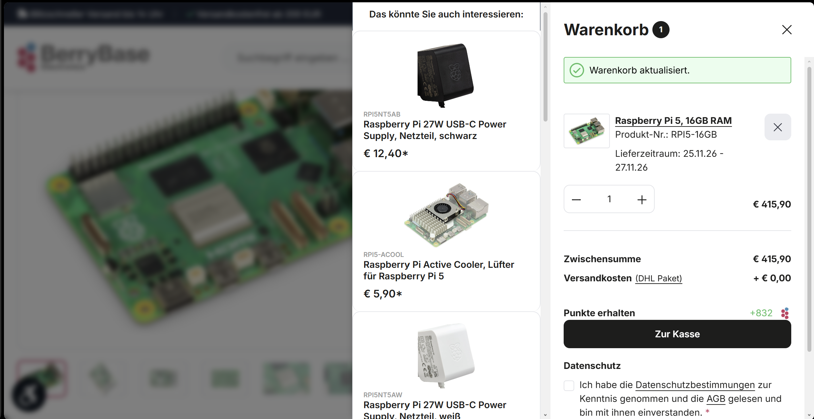

# Informatik README

> Diese Readme dient als Probe um in Informatik die README guidelines anzuwenden. Ich habe leider keine README vom IT Labor, da es bei mir setup Probleme gab.

---

## 📸 Screenshot

> Füge hier einen Screenshot der laufenden Applikation ein.




---

## Features

- Die App soll dabei helfen MarkDown und generell README besser zu verstehen.
- Die app soll einem lernen wie man eine MarkDown Datei richtig schreibt, und in welcher Reihenfolge.
- Sie soll uns auch als Basis für unseren anderen README Dateien dienen

---

## Voraussetzungen

- [] Eine Applikation die MarkDown lesen kann

---

## Installation

um zum Beispiel Git mit Winget zu installieren muss man ```winget install --id Git.Git -e --source winget``` eingeben

---

## Verwendung

Demo um MarkDown richtig zu schreiben bzw. Strukturieren

---

## Konfiguration

---

## Tests

Bei mir gibt es nicht zum Testen oder ausführen

---

## Mitwirken

Keine Mitwirkenden

---

## Lizenz

Autor: Jonathan Beetge
Dieses Projekt wurde im Rahmen des Schulunterrichts erstellt und ist nicht für die kommerzielle Nutzung vorgesehen.

---
